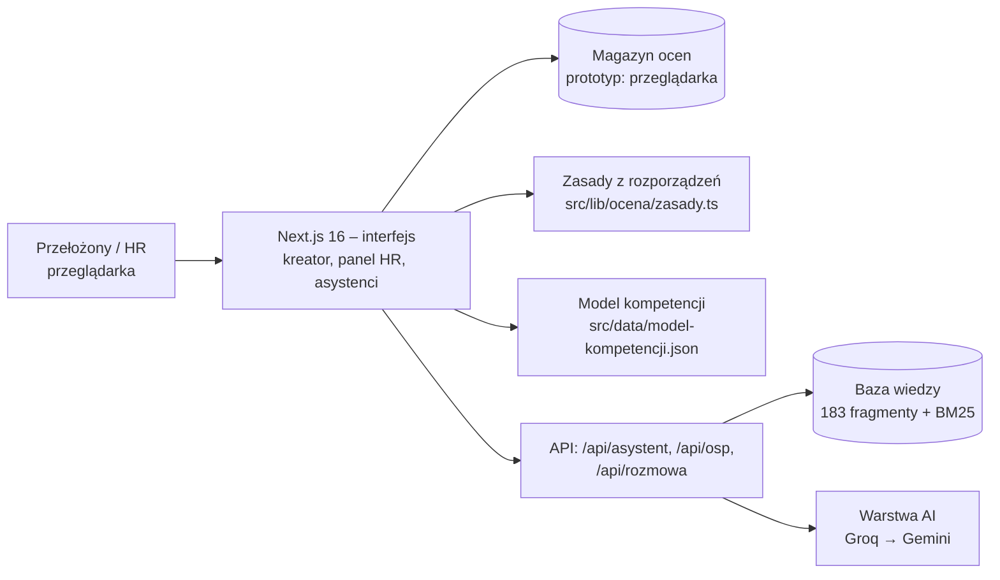

# Azymut

> Kompas kompetencji – przełożony krok po kroku przez pierwszą ocenę i ocenę okresową w służbie cywilnej.

Projekt zespołu **Bubylda** przygotowany podczas **HackNation 2026** (Bydgoszcz, 21–22.11.2026)
w ramach zadania **Kompas kompetencji** (Ministerstwo Cyfryzacji).

- 🌐 **Demo:** https://azymut-bubylda.vercel.app (bez logowania, dane demonstracyjne są fikcyjne)
- 🎬 **Wideo (do 2 min):** https://…
- 📊 **Prezentacja:** https://…
- 💻 **Kod:** https://github.com/vlad007vak/azymut

## Problem
Przełożony w służbie cywilnej musi połączyć przepisy, formularze, model kompetencji i rozmowę z pracownikiem.
Najtrudniejsze jest przełożenie obserwacji z całego okresu na poziom spełniania kryterium – różni przełożeni
interpretują te same kryteria różnie, a wiedza o procedurze jest rozproszona w rozporządzeniach i poradnikach.

## Rozwiązanie
Azymut prowadzi przełożonego przez cały proces w jednym miejscu, a decyzja zawsze pozostaje po jego stronie:

1. **Dwie ścieżki zgodne z rozporządzeniami** – pierwsza ocena (5 elementów, 3/5/7 pkt, warunki oceny
   pozytywnej) i ocena okresowa (arkusz B lub C, kryteria obowiązkowe + maks. 3 dodatkowe, skala 1–9 pkt).
2. **Ocena przez obserwowalne zachowania** – przy każdym wskaźniku behawioralnym przełożony wybiera opis
   zachowania z modelu kompetencji (14 kompetencji, 49 wskaźników, 5 poziomów) i zapisuje przykład
   (sytuacja – działanie – rezultat). System na bieżąco pokazuje **sugerowany poziom** z wyjaśnieniem.
3. **Decyzja przełożonego i wynik wg przepisów** – ostateczny poziom wybiera przełożony; aplikacja liczy
   średnią / ocenę łączną i wynik (pozytywna/negatywna) dokładnie według rozporządzeń i wymaga uzasadnienia
   przy ocenie negatywnej.
4. **Asystent formalny (AI)** – odpowiada na pytania o zasady oceny **wyłącznie na podstawie bazy wiedzy**
   (rozporządzenia, poradniki KPRM, model kompetencji), przy każdej odpowiedzi pokazuje źródło (dokument,
   paragraf lub strona, dosłowny cytat), a gdy w bazie nie ma odpowiedzi – mówi to wprost.
5. **Analiza opisu stanowiska (AI)** – z OSP podpowiada arkusz, kryteria dodatkowe i najważniejsze wskaźniki;
   każdą podpowiedź przełożony przyjmuje albo odrzuca.
6. **Asystent rozmowy (AI)** – plan rozmowy oceniającej: pytania do pracownika, kwestie do omówienia,
   argumenty uzasadniające ocenę i propozycje rozwoju, plus lista kontrolna z rozporządzenia.
7. **Dokument** – arkusz według wzoru z rozporządzenia, do wydruku lub zapisu jako PDF.
8. **Panel HR** – statusy wszystkich procesów, terminy (zbliżające się i przekroczone), nowy proces,
   przypomnienia dla oceniających.
9. **Role** – przełożony i HR (w prototypie role demonstracyjne; Panel HR tylko dla roli HR).

## Jak przetestować (dla jury)
Wszystko działa w przeglądarce na komputerze, bez zakładania konta. Dane demonstracyjne są fikcyjne
i zapisują się tylko w Twojej przeglądarce (przycisk „Resetuj dane demo” w Panelu HR przywraca stan początkowy).

1. Otwórz https://azymut-bubylda.vercel.app → w bloku „Ocena okresowa” kliknij **Anna Kowalczyk**
   (radca, arkusz C).
2. Krok **„Ocena wskaźników”**: przy dowolnym wskaźniku wybierz inne zachowanie – sugerowany poziom kryterium
   zmienia się od razu (np. rzetelność: średnia 4 pkt → „poniżej oczekiwań”).
3. **„Przejdź do rozmowy oceniającej”** → zadaj pytanie asystentowi formalnemu (np. „Ile kryteriów
   dodatkowych może wybrać oceniający?”) i rozwiń źródła; otwórz **„Przygotuj rozmowę”** (asystent rozmowy).
4. **„Rozmowa przeprowadzona – przejdź do decyzji”** → „Przyjmij sugestie” → wynik: średnia 5 pkt,
   **ocena pozytywna**. Dla sprawdzenia reguł ustaw jednemu kryterium **1 pkt** → ocena negatywna
   (§ 11 ust. 1 pkt 4), bez uzasadnienia nie da się jej sporządzić.
5. **„Sporządź ocenę na piśmie”** → podgląd arkusza → **„Drukuj / zapisz PDF”**.
6. Nowa ocena: strona główna → „Ocena okresowa” → **Rozpocznij ocenę** → w kroku 1 wybierz przykładowy opis
   stanowiska „Naczelnik wydziału” → **Analizuj** (arkusz B, kryteria dodatkowe z uzasadnieniem) → **Zastosuj**.
7. Pierwsza ocena: **Julia Mazur** – skala 3/5/7 pkt i warunki z § 10 rozporządzenia o pierwszej ocenie.
8. **Asystent formalny** (`/asystent`): pytania o terminy, kryteria i skalę; pytanie spoza tematu
   (np. o urlop) → komunikat „Brak informacji”.
9. **Panel HR** (`/hr`): wybierz rolę **„HR / administrator procesu”** (role demonstracyjne, bez hasła) → etapy
   i terminy procesów, nowy proces, przypomnienie. Rolę zmienisz w nagłówku („Zmień rolę”).

## Wykorzystanie sztucznej inteligencji
| Element | Co robi AI | Zabezpieczenia |
|---|---|---|
| Asystent formalny (`/asystent`, `POST /api/asystent`) | Formułuje odpowiedź na podstawie fragmentów bazy wiedzy znalezionych wyszukiwarką BM25 (183 fragmenty: oba rozporządzenia, poradniki KPRM, model kompetencji) | Model wskazuje tylko numery fragmentów – źródła i cytaty buduje serwer; gdy pytanie wykracza poza bazę → „Brak informacji”; imiona i nazwiska usuwane z pytania |
| Analiza opisu stanowiska (`POST /api/osp`) | Podpowiada kryteria dodatkowe i wskaźniki z uzasadnieniem z zadań na stanowisku | Arkusz B/C ustalany regułą (bez AI); serwer odrzuca kryteria obowiązkowe, nadmiarowe i nieistniejące wskaźniki; części OSP z danymi osobowymi usuwane przed wysłaniem |
| Asystent rozmowy (`POST /api/rozmowa`) | Plan rozmowy oceniającej oparty na zapisanych przykładach zachowań | Do AI trafia tylko stanowisko, kryteria i przykłady (anonimizowane); prompt zabrania oceniania i dodawania faktów |

**Gdzie AI nie działa:** poziomy, punkty, średnie i wynik oceny liczy deterministyczny kod
(`src/lib/ocena/zasady.ts`) według rozporządzeń. Sugestia poziomu wynika z wybranych przez przełożonego
zachowań, a ostateczny poziom zawsze wybiera przełożony – AI pełni wyłącznie funkcję doradczą.

Modele: darmowe API zgodne z OpenAI – Groq (`qwen/qwen3.8-27b`) z automatycznym przełączeniem na Google Gemini
(`gemini-3.5-flash-lite`); warstwa `src/lib/ai` pozwala podmienić dostawcę (np. na model uruchomiony w infrastrukturze urzędu).

## Architektura



- **Frontend i API:** Next.js 16 (App Router, React 19, TypeScript), Tailwind CSS 4, shadcn/ui (Base UI);
  hosting Vercel. Każda funkcja w osobnym module (`src/features/*`), wspólny kontrakt typów (`src/types`).
- **Dane:** model kompetencji generowany z pliku organizatora skryptem `scripts/model-z-xlsx.py`;
  baza wiedzy generowana z PDF skryptem `scripts/baza-wiedzy/zbuduj.mjs` – po zmianie przepisów wystarczy
  przebudować pliki.
- **Walidacja:** każde żądanie API sprawdzane schematem zod; klucze AI tylko po stronie serwera.

## Bezpieczeństwo i ochrona danych
- **Minimalizacja danych:** do modeli AI nie trafiają imiona ani nazwiska – tylko stanowisko, kryteria
  i opisy zachowań (dodatkowo automatyczna anonimizacja treści).
- **Dane w prototypie** zapisują się wyłącznie w przeglądarce użytkownika (brak serwerowej bazy danych osobowych).
- **Decyzja człowieka:** AI nie ustala poziomu ani wyniku oceny.
- **Przed wdrożeniem produkcyjnym** (do zrobienia): uwierzytelnianie przez system urzędu (np. SSO) i autoryzacja
  ról po stronie serwera; baza danych w infrastrukturze urzędu z szyfrowaniem i dziennikiem dostępu; model
  językowy hostowany w infrastrukturze urzędu lub u dostawcy z umową powierzenia danych; analiza ryzyka dla
  ochrony danych osobowych; testy bezpieczeństwa i dostępności.

## Kierunki rozwoju i wdrożenia
- Integracja z systemami kadrowymi (np. QNT) – pobieranie danych pracownika i opisu stanowiska.
- Integracja z systemem klasy EZD – przekazanie podpisanego arkusza do akt.
- Rozbudowa panelu HR o raporty dla urzędu i powiadomienia e-mail.
- Udostępnienie innym urzędom administracji – model kompetencji i baza wiedzy jako konfigurowalne pliki.

## Uruchomienie lokalne
```bash
npm install
cp .env.example .env.local   # uzupełnij klucze GROQ_API_KEY / GEMINI_API_KEY
npm run dev                  # http://localhost:3000
```

## Wykorzystane zasoby
Zgodnie z zasadami HackNation informujemy o zasobach przygotowanych lub użytych poza czasem hackathonu:

- **Szablon startowy** przygotowany przez zespół przed wydarzeniem: konfiguracja Next.js + Tailwind + shadcn/ui,
  układ strony po polsku, warstwa AI z przełączaniem darmowych dostawców (`src/lib/ai`), komponent czatu.
  Cała logika związana z zadaniem powstała podczas hackathonu.
- **Biblioteki open source:** Next.js, React, Tailwind CSS, shadcn/ui, Base UI, lucide-react, sonner, zod,
  openai (klient API), react-markdown, remark-gfm.
- **Narzędzia do budowy bazy wiedzy asystenta:** `pdftotext` (Poppler) do wyciągnięcia tekstu z PDF; wyszukiwanie
  fragmentów (BM25) napisane przez zespół bez zewnętrznych bibliotek.
- **Narzędzia AI:** kod powstawał z pomocą asystenta Claude Code; w aplikacji – darmowe API Groq i Google Gemini.
- **Źródła danych i wiedzy:** model kompetencji (14 kompetencji, 49 wskaźników behawioralnych) oraz wzory arkuszy,
  poradniki KPRM i przykładowe opisy stanowisk – materiały organizatora zadania (Ministerstwo Cyfryzacji);
  rozporządzenie Prezesa Rady Ministrów z 4.04.2016 w sprawie ocen okresowych (Dz.U. 2016 poz. 470);
  rozporządzenie Prezesa Rady Ministrów z 23.07.2015 w sprawie pierwszej oceny (Dz.U. 2015 poz. 1144);
  ustawa o służbie cywilnej (t.j. Dz.U. 2026 poz. 590). Dane pracowników w wersji demo są fikcyjne.

## Zespół Bubylda
- Vladyslav Vakula – lead programmer, integracja, kreator oceny, Vercel
- Maks – asystent formalny i baza wiedzy, kontakt z mentorami
- Andrey – panel HR, role, prezentacja (pitch)
- Dima – asystent rozmowy, analiza opisu stanowiska, eksport i API
- Diana – testy i raporty z testów
